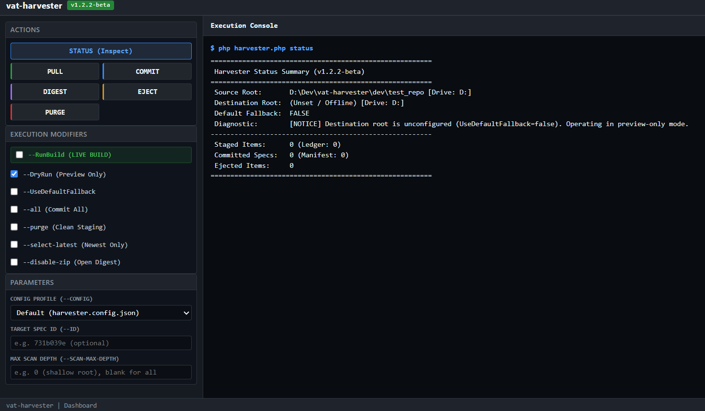

# vat-harvester (Version 1.0.0)

```
# Copyright (c) 2026:
# vatofichor - Sebastian Mass     [>_<]
# & Assisted By Gemini Antigravity /|\
```

---

Workspace file aggregator, staging engine, antipattern ejector, streaming open digest compiler, and simplex web GUI dashboard.

---

## 1. Simplex Web GUI Dashboard (`:8091`)

`vat-harvester` includes a zero-dependency, high-density retro dark grid web GUI powered directly by PHP's built-in CLI webserver.

### Screenshot



### Launching the GUI

- **Windows**: Double-click `vat-harvester.bat` (or run in terminal).
- **Linux / macOS**: Run `./vat-harvester.sh` (or `sh vat-harvester.sh`).

The launcher automatically starts the local server on `http://127.0.0.1:8091` and opens your default browser.

### GUI Features
- **Action Launchers**: Single-click buttons for `STATUS`, `PULL`, `COMMIT`, `DIGEST`, `EJECT`, and `PURGE`.
- **Execution Modifiers**: Checkboxes for `--RunBuild` (Live Execution), `--DryRun` (Safe Preview), `--UseDefaultFallback`, `--all`, `--purge`, `--select-latest` (Newest Only), and `--disable-zip` (Open Digest).
- **Parameters**: Inputs for `--config`, `--id` (Spec Hash), and `--scan-max-depth` (Directory Recursion Depth).
- **Profile Selector**: Choose from detected configuration profiles (`harvester.config.json`, `config/default.config.json`, `testing/*.config.json`) or specify custom paths.
- **Inline Terminal Console**: Real-time buffered execution output with auto-scroll and clear screen capabilities.

---

## 2. Quick CLI Command Reference

Execute via `harvester.bat <subcommand> [flags]` (Windows), `./harvester.sh <subcommand> [flags]` (Linux), or `php harvester.php <subcommand> [flags]`:

```cmd
harvester status                               Display source, destination, and repository summary
harvester pull                                 Dry-run preview of candidate specs to stage
harvester pull --RunBuild                      Execute live staging into repository stage area
harvester pull --select-latest --RunBuild      Stage only newest candidate per directory/family
harvester pull --scan-max-depth=0 --RunBuild   Limit scanning to immediate root without descending
harvester pull --purge --RunBuild              Clear existing staging items and live stage fresh specs
harvester eject                                Dry-run preview of antipattern candidates
harvester eject --RunBuild                     Move antipattern candidate files to unspec/
harvester commit --id=<ID>                     Dry-run preview of promoting specific staged item
harvester commit --id=<ID> --RunBuild          Promote specific staged item to repository specs
harvester commit --all --RunBuild              Promote all staged items to repository storage
harvester purge                                Dry-run preview of uncommitted items to be cleared
harvester purge --RunBuild                     Clear temporary staging buffer and reset ledger
harvester digest                               Dry-run preview of specs to be digested
harvester digest --RunBuild                    Generate markdown digest report and native zip archive
harvester digest --disable-zip --RunBuild      Stream open markdown digest with SHA-256 without zipping
```

### Global Flags

| Flag | Description |
| :--- | :--- |
| `--RunBuild` | Execute live filesystem mutations (default mode is non-destructive Dry-Run) |
| `--DryRun` | Force non-destructive preview mode |
| `--UseDefaultFallback` | Allow fallback to software install root when destination root is unset |
| `--config=<path>` | Specify custom JSON configuration profile (strict upfront validation) |
| `--id=<ID>` | Target specific spec hash identifier for commit or eject |
| `--select-latest` | Retain only newest candidate per group/stem, filtering historical duplicates |
| `--latest-grouping=<mode>` | Deduplication grouping strategy: `directory` (default) or `regex` |
| `--disable-zip` | Bypass `ZipArchive` packaging; generate streaming markdown digest only |
| `--scan-max-depth=<N>` | Limit directory scanning recursion depth (`0` = immediate folder only) |

---

## 3. Shell & Batch File Shortcuts (`/bin`)

Platform-specific shortcuts forward arguments directly to the master engine:

| Windows (`.bat`) | Linux / POSIX (`.sh`) | Command Executed |
| :--- | :--- | :--- |
| `harvester.bat` *(Root)* | `harvester.sh` *(Root)* | Master CLI engine forwarder |
| `vat-harvester.bat` *(Root)* | `vat-harvester.sh` *(Root)* | Simplex Web GUI dashboard launcher (`:8091`) |
| `bin/pull_specs.bat` | `bin/pull_specs.sh` | Runs `harvester pull` (supports `--RunBuild`, `--purge`) |
| `bin/commit_staged.bat <ID>` | `bin/commit_staged.sh <ID>` | Runs `harvester commit <ID>` |
| `bin/commit_all.bat` | `bin/commit_all.sh` | Runs `harvester commit --all` |
| `bin/digest_cycle.bat` | `bin/digest_cycle.sh` | Runs `harvester digest` |

*Note: CLI scripts automatically maintain terminal persistence so output remains visible for inspection.*

---

## 4. Configuration & Decoupled Logging (`harvester.config.json`)

`vat-harvester` decouples the source scan root from destination repository storage across different drives and directories:

```json
{
  "domain": "specs",
  "use_default_fallback": false,
  "source_drive": "C:",
  "source_root": "./workspace",
  "source_subdirs": [
    "specs",
    "docs/specs"
  ],
  "scan_max_depth": null,
  "select_latest_only": false,
  "latest_grouping": "directory",
  "disable_digest_zip": false,
  "digest_mode": "zip",
  "destination_drive": "C:",
  "destination_root": "./repo",
  "paths": {
    "stage_dir": "repo/stage",
    "repo_items_dir": "repo/specs",
    "eject_dir": "unspec",
    "stage_ledger": "stage-ledger.txt",
    "spec_manifest": "spec-manifest.txt",
    "lock_file": "repo/.harvester.lock",
    "digests_dir": "digests"
  },
  "rules": {
    "primary_spec_regex": "/[_-]specs?\\.[^.]+$/i",
    "antipattern_regex": "/(?:^|[-_.,0-9])(?:unspec|unitem|exitm)(?:$|[-_.,0-9])/i"
  }
}
```

- **Runtime Requirement**: PHP 8.3.0 or higher is strictly required (`PHP_VERSION_ID >= 80300`).
- **Traversal Depth Restriction**: `"scan_max_depth": 0` stops file crawler recursion at immediate root directories, avoiding heavy nested folders (`vendor`, `node_modules`, `.bkup`).
- **Latest File Deduplication**: `"select_latest_only": true` compares file modification times (`filemtime`) and natural filename ordering, staging only the single newest asset per directory or regex stem.
- **Streaming Open Digest**: `"disable_digest_zip": true` or `"digest_mode": "open"` eliminates redundant "ZIP of ZIPs" operations on pre-compressed assets, outputting stream-written markdown reports with chunked SHA-256 signatures at zero RAM overhead.
- **Decoupled Ledger & Manifest**: `paths.stage_ledger` and `paths.spec_manifest` accept custom filenames, absolute paths, or directory targets (e.g. `"custom_logs/"`), allowing per-config isolated or overlapping log sets while maintaining root fallbacks when unspecified.
- **Cross-Drive Operations**: File transfers across drive boundaries execute verified copy + size integrity check + source unlink, preventing Windows `EXDEV` cross-device link errors.

---